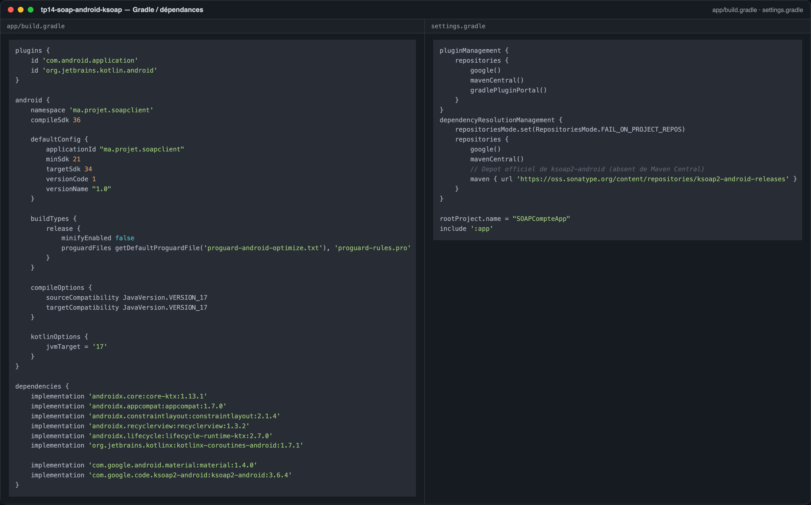
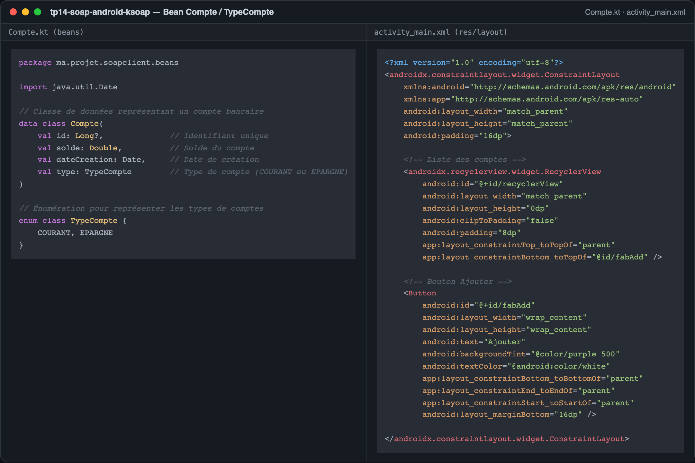
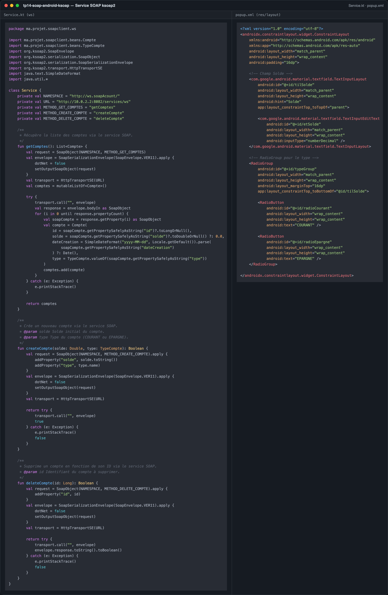
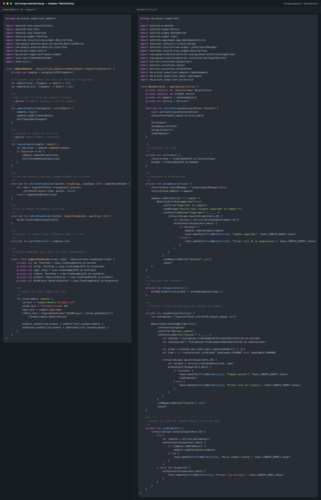
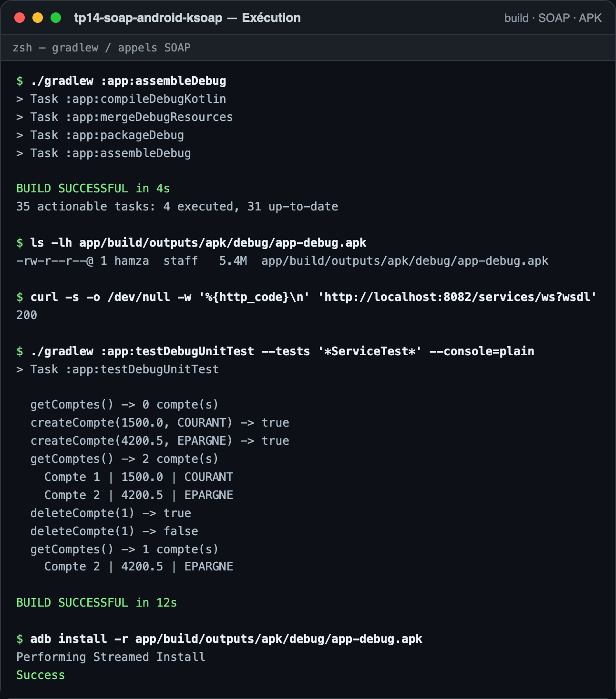

# TP 14 : Client SOAP Android Kotlin avec KSOAP

Application Android en Kotlin qui consomme le service web SOAP `BanqueWS` (TP 13) avec la bibliothèque **ksoap2**, affiche la liste des comptes dans un `RecyclerView` et permet de créer puis de supprimer un compte.

## 1. Projet Kotlin et dépendances Gradle

Le module `app` déclare les bibliothèques Material, RecyclerView, Coroutines et surtout `com.google.code.ksoap2-android:ksoap2-android:3.6.4`. Cette version n'est **pas publiée sur Maven Central** : le dépôt `ksoap2-android-releases` de Sonatype est donc ajouté dans `settings.gradle` pour que la dépendance soit résolue.

## 2. Bean `Compte` / `TypeCompte` et layout principal

Le bean `Compte` (data class Kotlin) porte `id`, `solde`, `dateCreation` et `type`, ce dernier étant l'énumération `TypeCompte` (`COURANT`, `EPARGNE`). Le layout `activity_main.xml` contient le `Toolbar`, le `RecyclerView` et le bouton flottant d'ajout, avec un `ProgressBar` pendant le chargement.

## 3. Service SOAP avec ksoap2

`Service.kt` construit pour chaque opération (`getComptes`, `createCompte`, `deleteCompte`) un `SoapObject` dans le namespace `http://ws.soapAcount/`, l'envoie avec `SoapSerializationEnvelope` (SOAP 1.1) via `HttpTransportSE` vers `http://10.0.2.2:8082/services/ws`, puis convertit la réponse SOAP en objets `Compte`. Le layout `popup.xml` fournit le formulaire de création (solde + type).

## 4. Adapter RecyclerView et MainActivity

`CompteAdapter` alimente la liste (identifiant, solde, type, date) et remonte la suppression au travers d'un callback. `MainActivity` charge les comptes dans une coroutine sur `Dispatchers.IO`, affiche le dialogue d'ajout, puis rafraîchit la liste après chaque création ou suppression.

## 5. Exécution : build de l'APK et appels SOAP

`./gradlew :app:assembleDebug` produit `app/build/outputs/apk/debug/app-debug.apk` (5,4 Mo). Le cycle complet du client ksoap2 a été exécuté contre le service JAX-WS `BanqueWS` du TP 13 : liste vide, deux créations, liste de deux comptes, suppression (premier appel `true`, second `false`) et liste finale.

### Remarques d'exécution

- Le client Android vise `http://10.0.2.2:8082`, l'adresse de la machine hôte vue depuis l'émulateur ; le service SOAP du TP 13 doit être démarré sur le port `8082`.
- L'émulateur n'a pas pu être lancé sur ce poste (espace disque insuffisant, `device does not have enough disk space to run avd`), et aucun appareil physique n'était connecté. La vérification des appels SOAP a donc été faite en exécutant la classe `Service` sur la JVM contre le service réel, avec un namespace aligné sur celui du service (`http://ws.demo.example.com/`) et une URL `http://localhost:8082` ; le code livré conserve les valeurs du TP (`http://ws.soapAcount/` et `10.0.2.2`).
- Deux corrections minimales ont été nécessaires par rapport au code du TP pour que ksoap2 fonctionne : le solde est envoyé en `String` (`addProperty("solde", solde.toString())`, ksoap2 3.6.4 ne sachant pas sérialiser un `Double`) et la réponse booléenne de `deleteCompte` est convertie depuis le `SoapPrimitive` retourné (`envelope.response.toString().toBoolean()`).
